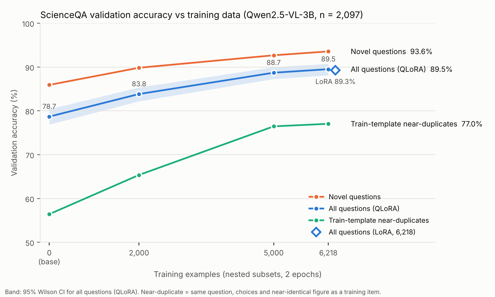

# VisionTune AI

Parameter-efficient fine-tuning (LoRA and QLoRA) of **Qwen2.5-VL-3B-Instruct** for scientific visual question answering,
trained on **ScienceQA** and evaluated for transfer on **AI2D**. The project measures whether targeted adaptation improves
STEM VQA, and what it costs in memory, time and latency.

> Experimental research project. Model answers are not verified scientific facts.

Full plan: [`docs/blueprint.md`](docs/blueprint.md) (v1.1; its revision log lists what changed from the original plan and why).

## Status

| Milestone | State |
|---|---|
| M1 Setup | ✅ Done on a Kaggle T4: model loads, inference and the QLoRA path verified (`results/reports/phase1/`) |
| M2 Dataset | ✅ Validated, de-duplicated pipeline run on the real data (see below) |
| M3 Baseline | ✅ M0 = 78.7% on the full validation split (n = 2,097) |
| M4 LoRA · M5 QLoRA | ✅ Full data (6,218 examples): LoRA 89.3%, QLoRA 89.5% (equal, p = 0.61); QLoRA uses 44% less training VRAM |
| M6 Benchmarking | ✅ Validation scaling study, held-out ScienceQA test and AI2D transfer evaluation done |
| M7–M9 | Not started |

### Final held-out result (ScienceQA **test**, n = 2,017, evaluated once)

| Model | Test accuracy | Δ vs base | Peak train VRAM | Peak inference VRAM |
|---|---:|---:|---:|---:|
| M0 Qwen2.5-VL-3B (no fine-tuning) | 81.1% | n/a | n/a | 7.69 GB |
| LoRA (6,218 examples) | 90.8% | +9.7 pp | 8.82 GB | 7.72 GB |
| **QLoRA (6,218 examples)** | **91.5%** | **+10.5 pp** | **4.95 GB** | **3.89 GB** |

Both gains are significant (p < 1e-29). QLoRA vs LoRA differs by +0.7 pp, which is not significant (p = 0.07). Novel test questions improve by +7.5 pp,
and questions sharing a training template by +19.9 pp. Details: [`results/reports/test/README.md`](results/reports/test/README.md).

### Cross-dataset transfer (AI2D test, n = 3,088, never used for training)

| Model | AI2D accuracy | Δ vs base |
|---|---:|---:|
| M0 base | 79.3% | n/a |
| LoRA (6,218) | 77.9% | −1.5 pp (p = 0.003) |
| QLoRA (6,218) | 78.5% | −0.9 pp (n.s.) |

**The ScienceQA gain does not transfer** (H5 supported). The adapters learned ScienceQA's question templates and
answer style, not general diagram understanding. Details: [`results/reports/ai2d/README.md`](results/reports/ai2d/README.md).

### Development results (ScienceQA **validation**, n = 2,097)



| Model | Train examples | Accuracy | Δ vs base | Peak train VRAM |
|---|---:|---:|---:|---:|
| M0 Qwen2.5-VL-3B (no fine-tuning) | n/a | 78.7% | n/a | n/a |
| QLoRA | 500 | 80.0% | +1.3 pp | 4.96 GB |
| QLoRA | 2,000 | 83.8% | +5.2 pp | 4.96 GB |
| QLoRA | 5,000 | 88.7% | +10.0 pp | 4.96 GB |
| QLoRA | 6,218 | **89.5%** | **+10.8 pp** | 4.95 GB |
| LoRA | 6,218 | 89.3% | +10.6 pp | 8.82 GB |

All gains over the base are significant (paired bootstrap and McNemar; p = 0.03 at 500 examples, p < 0.001 from 2,000). Returns diminish after ~5,000 examples
(+0.8 pp from 5,000 → 6,218, n.s.). Questions whose template and figure also appear in training gain more (+20.6 pp)
than novel ones (+7.6 pp). Both are reported throughout. Full write-up: [`results/reports/scaling/README.md`](results/reports/scaling/README.md).

### Data, as prepared (`results/reports/data/prepare_report.json`)

| ScienceQA split | Raw | With image (used) | Test-template near-duplicates flagged |
|---|---:|---:|---:|
| train | 12,726 | 6,218 | n/a |
| validation | 4,241 | 2,097 | 514 |
| test | 4,241 | 2,017 | 482 |
| AI2D test (eval only) | 3,088 | 3,088 | n/a |

## Quick start on Kaggle

1. Create a notebook. Set **Accelerator → GPU** and **Internet → On**.
2. **File → Import notebook**, upload `notebooks/01_environment_setup.ipynb` (or paste its GitHub URL), then *Run all*.
   It clones the repo, installs pinned-minimum dependencies, loads the model, and runs real ScienceQA inference with a numerics
   check. It also tests the 4-bit QLoRA path and writes everything to `/kaggle/working/phase1/`.

Then run these from the cloned repo (prefix each with `!` in a notebook cell):

```bash
python -m visiontune.data.prepare --config configs/base.yaml
```

```bash
python -m visiontune.inference.predict --config configs/base.yaml --split validation --limit 200
```

```bash
python -m visiontune.training.train --config configs/smoke.yaml
```

```bash
python -m visiontune.training.train --config configs/lora.yaml
```

```bash
python -m visiontune.training.train --config configs/qlora.yaml train.max_train_samples=2000
```

```bash
python -m visiontune.inference.predict --config configs/lora.yaml --adapter outputs/scienceqa_qwen25vl3b_lora_r16_seed42/adapter --split validation
```

In order, these: prepare and validate the data (about 5 minutes on CPU), run the M0 baseline on a validation subset, run the overfit smoke test (do this before any real run), train LoRA (500-example pilot by default), train QLoRA with a config override, and evaluate an adapter.

If a Kaggle session ends, add `--resume` to the training command to continue from the last checkpoint. Prediction runs resume automatically.

## Local development (CPU)

```bash
pip install -e ".[train,dev]"
```

```bash
pytest
```

The test suite (37 tests, about 20 s) covers config inheritance, data validation and leakage checks, answer extraction,
statistics, and LoRA target resolution. It also checks loss masking and a full train → save → reload → predict loop on a tiny,
randomly initialized Qwen2.5-VL. The tiny-model tests download the real processor (no weights) and skip offline.

## Repository layout

```text
configs/            base.yaml → lora.yaml → qlora.yaml / smoke.yaml (inheritance via `extends:`)
src/visiontune/
  data/             record schema, prepare (validate · dedup · leakage), nested sampling
  models/           model/processor loading (LoRA, QLoRA, inference), LoRA target presets
  training/         loss-masking collator, Trainer-based train CLI
  evaluation/       answer extraction, accuracy CIs, paired bootstrap, McNemar
  inference/        resumable batched predict + metrics CLI
  prompts.py        the one prompt/target formatter shared by every model
notebooks/          Kaggle notebooks (01 setup · 02 LoRA pilot · 03 QLoRA pilot · 04 data-scaling run)
results/reports/    committed reports (data prep, phase outputs)
docs/blueprint.md   project plan and methodology
tests/
```

Every training run writes `config.yaml`, `sample_ids.json`, `environment.json` and `run_summary.json` next to its adapter.
These record the exact examples, settings, versions, hardware, peak VRAM, time and adapter size.

## Licenses and attribution

- **Code in this repository:** [MIT](LICENSE). This covers the code only, not the model, the datasets or trained adapters.
- **Model:** Qwen2.5-VL-3B-Instruct, [Qwen Research License](https://huggingface.co/Qwen/Qwen2.5-VL-3B-Instruct/blob/main/LICENSE)
  (non-commercial). Adapters trained here inherit these terms.
- **ScienceQA:** Lu et al., *Learn to Explain* (NeurIPS 2022), [CC BY-NC-SA 4.0](https://scienceqa.github.io/).
- **AI2D:** Kembhavi et al., *A Diagram Is Worth A Dozen Images* (ECCV 2016), [allenai.org/data/diagrams](https://allenai.org/data/diagrams).
- Raw data, processed records and model weights are not committed.
