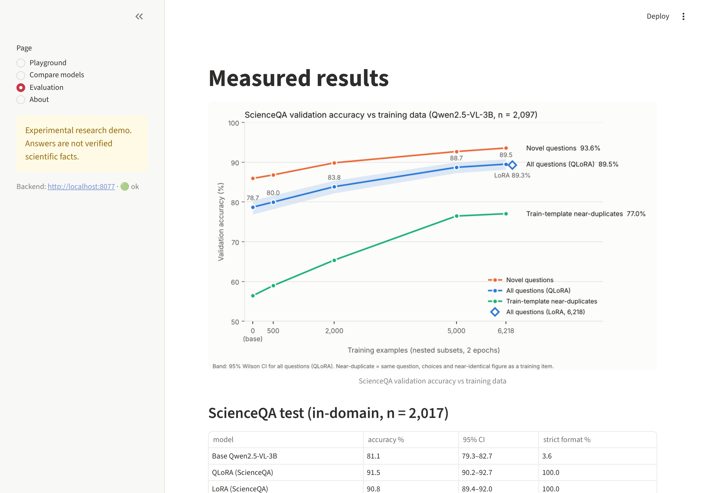

# Running and deploying the demo (M7 / M8)

The demo has two parts (blueprint §8–10):

| Part | Code | Needs |
|---|---|---|
| Inference API (FastAPI) | `backend/main.py`, engine in `src/visiontune/serving/engine.py` | GPU recommended (4-bit base needs about 4 GB VRAM) |
| Web UI (Streamlit) | `frontend/app.py` | CPU only; talks to the API via `BACKEND_URL` |

The API loads the base model **once** at startup and attaches every adapter to it. Each request picks `base`, `qlora` or
`lora`, and generation is serialised by a lock, so scale with more workers rather than threads.

## 1. Put the adapters in place

Each adapter folder needs `adapter_config.json` and `adapter_model.safetensors` (about 28 MB each). These are produced by the
training notebooks (Kaggle notebooks `visiontune-04-qlora-n6218` and `visiontune-04-lora-n6218`, under
`outputs/<run>/adapter/`). Download them from the notebook output page:

```text
adapters/qlora_n6218/{adapter_config.json, adapter_model.safetensors}
adapters/lora_n6218/{adapter_config.json, adapter_model.safetensors}
```

`adapters/` is git-ignored. Missing adapter folders are skipped, so the API still serves `base`.

## 2. Run locally

```bash
pip install -e . -r requirements-app.txt
```

```bash
VISIONTUNE_CONFIG=configs/serve.yaml uvicorn --factory backend.main:create_app --port 8000
```

```bash
BACKEND_URL=http://localhost:8000 streamlit run frontend/app.py
```

Settings live in `configs/serve.yaml`: 4-bit vs 16-bit base, adapter paths, upload limits (8 MB, 4,096 px), max
question length, rate limit (20 requests/min per IP) and the feedback log path.

## 3. API

| Endpoint | Method | Purpose |
|---|---|---|
| `/health` | GET | Liveness and loading state |
| `/models` | GET | Available variants and the default |
| `/model-info` | GET | Base model, revision, quantization, device |
| `/predict` | POST (multipart) | `image`, `question`, optional `choices` (JSON list or one per line), `context`, `model` |
| `/compare` | POST (multipart) | Same inputs; runs every variant |
| `/metrics` | GET | Committed evaluation results (ScienceQA test, AI2D, scaling runs) |
| `/feedback` | POST (JSON) | Stores user feedback on an answer (`data/feedback/feedback.jsonl`) |

Validation: PNG, JPEG or WebP only (415 otherwise); size limit (413); unreadable or oversized images, 2–10 choices,
and unknown model names return 422; rate limit returns 429.

## 4. Deploy (not done yet: needs accounts and a decision on hosting cost)

- **Frontend:** a Hugging Face Space (Streamlit SDK) with `frontend/app.py` and `requirements-app.txt`, and the `BACKEND_URL`
  secret pointing at the API.
- **API:** any GPU host that runs the `Dockerfile` (for example RunPod or Modal). A T4-class GPU is enough for the 4-bit base.
  Mount the adapters at `/app/adapters`.
- **Licensing:** the base model is under the Qwen Research License, and the adapters are trained on ScienceQA (CC BY-NC-SA).
  A public demo must stay non-commercial and carry both attributions; the About page already states this.



## Tests

`tests/test_serving.py` covers every endpoint, input validation, rate limiting, adapter switching on a tiny real model
(base output unchanged after adapter calls), and that every Streamlit page renders with the backend offline. It runs on CPU.
