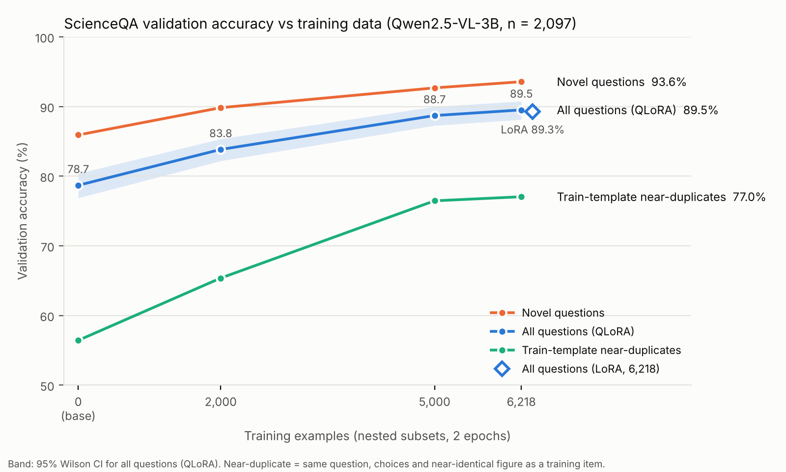

# VisionTune AI: Final Project Report

**Parameter-efficient fine-tuning of Qwen2.5-VL-3B-Instruct for scientific visual question answering**

Author: akhilnathreddy · Repository: `akhilnathreddy/VisionTune` · Date: November 2026
Compute: one NVIDIA Tesla T4 (16 GB) on Kaggle, about 28.5 GPU-hours in total

---

## Abstract

We fine-tune the open vision-language model Qwen2.5-VL-3B-Instruct [3] on the image subset of ScienceQA [1] with LoRA [4] and
QLoRA [5]. We compare the two methods on accuracy, memory and speed, study how accuracy scales with training data, and test
transfer to an unseen diagram benchmark, AI2D [2]. On the held-out ScienceQA test split (2,017 image questions, evaluated
once), accuracy rises from **81.1%** (base model) to **90.8%** with LoRA and **91.5%** with QLoRA (+9.7 and +10.5 percentage
points; both p < 1e-29). The two methods are statistically indistinguishable (+0.7 pp, p = 0.07), but QLoRA needs **44% less
training memory** (4.95 vs 8.82 GB) and **49% less inference memory** (3.89 vs 7.72 GB), at about 21% lower generation
speed on a T4. Accuracy grows steeply up to about 5,000 training examples and then flattens. The gains do **not** transfer:
on AI2D the adapters score at or slightly below the base model (79.3% base, 78.5% QLoRA, 77.9% LoRA). A per-item analysis
shows the largest gains on test questions whose template and figure also appear in training (+19.9 pp) versus novel
questions (+7.5 pp). Together, these results indicate the adapters learned ScienceQA's question templates and answer style
more than general diagram reasoning.

---

## 1. Goals and research questions

The project asked whether targeted, parameter-efficient adaptation of a pretrained VLM improves scientific visual question
answering, and at what computational cost. It tested five hypotheses from the project blueprint (`docs/blueprint.md`):

| | Hypothesis |
|---|---|
| H1 | Fine-tuning improves STEM VQA performance over the pretrained baseline |
| H2 | LoRA and QLoRA achieve similar task performance |
| H3 | QLoRA reduces training memory requirements |
| H4 | More training data helps up to a point, after which gains diminish |
| H5 | Improvements on the training domain may not transfer to unseen scientific-diagram domains |

## 2. Data

**ScienceQA** [1] (Hugging Face mirror `derek-thomas/ScienceQA`, pinned revision). We kept only questions with an image,
because the study is about visual question answering. We preserved the official splits.

| Split | Raw | With image (used) |
|---|---:|---:|
| train | 12,726 | 6,218 |
| validation | 4,241 | 2,097 |
| test | 4,241 | 2,017 |

**Preprocessing** (`src/visiontune/data/`):
- Every image is decoded and every record validated (non-empty question, 2–10 options, answer in range). Exclusion reasons
  are logged in `results/reports/data/prepare_report.json`.
- Exact duplicates are removed within splits. Exact cross-split duplicates are removed (none remained after filtering).
- **Near-duplicates are flagged, not removed.** A near-duplicate has the same question, the same set of choices, and an
  image whose perceptual hash (dHash) differs by at most 6 of 64 bits. We first tried removing them, but an audit showed that
  261 of 1,093 such train–test pairs have *different* correct answers: ScienceQA's templated magnet and particle diagrams
  differ only in small details. We therefore flag validation and test items that have a near-duplicate in training (514 and
  482 items) and report results on flagged and novel items separately.

**AI2D** [2] (`lmms-lab/ai2d`, test split, 3,088 four-option questions). Used only for evaluation, never for training,
model selection or prompt design.

## 3. Method

**Model.** Qwen2.5-VL-3B-Instruct [3], pinned revision. Every image is capped at 128–512 visual tokens through the processor's
pixel limits.

**Training target.** Supervised fine-tuning on `Answer: <letter>. <option>` followed by `Explanation: <ScienceQA solution>`
(trimmed to 600 characters). Loss is computed only on the assistant reply: system text, user text, vision tokens and padding
are masked.

**Adapters.** LoRA [4] with rank 16, α = 32, dropout 0.05, on the language model's attention projections (q/k/v/o in all 36
layers: 144 modules, 7.37 M trainable parameters, 0.20% of the model). QLoRA [5] uses the same adapters on a 4-bit NF4 base
with double quantization. The vision tower and `lm_head` stay in 16-bit.

**Optimisation.** 2 epochs, learning rate 1e-4 with cosine decay and 3% warmup, batch 1 × gradient accumulation 8, gradient
checkpointing, fp16 mixed precision. AdamW for LoRA, paged 8-bit AdamW for QLoRA. Seed 42.

**Data scaling.** Nested subsets of 500, 2,000, 5,000 and 6,218 training examples, so each smaller set is contained in the
larger ones and the curve reflects quantity alone.

**Evaluation.** All models are scored on the same questions with the same prompt, greedy decoding, at most 160 new tokens,
batch 8. Answers are parsed by a fixed procedure that records *how* each answer was found (strict `Answer: X` / lenient /
option text / none), so format compliance is reported separately from accuracy. We report Wilson 95% intervals [8],
paired-bootstrap confidence intervals on differences [9], and exact McNemar tests [7]. Every choice was made on the
validation split. The test split and AI2D were each evaluated **once**, at the end.

Software: PyTorch, Transformers [6] 5.23, PEFT 0.22, bitsandbytes 0.50, on Kaggle with Python 3.13.

## 4. Results

### 4.1 Pilot (500 examples, 500 validation questions)

The first pilot showed **no accuracy change** (base 79.0%, LoRA 79.2%, QLoRA 79.0%). It did show **format compliance rising
from 4% to 100%**, and that QLoRA used 4.96 GB of training memory against 8.83 GB for LoRA. Re-scoring the 500-example
adapter on the full validation split later revealed a small real gain (+1.3 pp, p = 0.03) that the smaller pilot sample could
not resolve.

### 4.2 Data scaling (ScienceQA validation, n = 2,097)

| Model | Train examples | Accuracy (95% CI) | Δ vs base | Train time (T4) | Peak train VRAM |
|---|---:|---:|---:|---:|---:|
| Base | n/a | 78.7% (76.9–80.4) | n/a | n/a | n/a |
| QLoRA | 500 | 80.0% (78.2–81.6) | +1.3 pp (p = 0.03) | 26 min | 4.96 GB |
| QLoRA | 2,000 | 83.8% (82.2–85.3) | +5.2 pp | 93 min | 4.96 GB |
| QLoRA | 5,000 | 88.7% (87.3–90.0) | +10.0 pp | 261 min | 4.96 GB |
| QLoRA | 6,218 | 89.5% (88.1–90.7) | +10.8 pp | 282 min | 4.95 GB |
| LoRA | 6,218 | 89.3% (87.9–90.5) | +10.6 pp | 288 min | 8.82 GB |

Marginal gains between budgets were **+3.9 pp** (500 → 2,000), **+4.9 pp** (2,000 → 5,000) and **+0.8 pp** (5,000 → 6,218,
p = 0.09, not significant).

### 4.3 Held-out ScienceQA test (n = 2,017, evaluated once)

| Metric | Base | LoRA (6,218) | QLoRA (6,218) |
|---|---:|---:|---:|
| **Accuracy (95% CI)** | 81.1% (79.3–82.7) | **90.8%** (89.4–92.0) | **91.5%** (90.2–92.7) |
| Δ vs base (95% CI) | n/a | +9.7 pp (+8.1, +11.4) | +10.5 pp (+8.8, +12.2) |
| McNemar (base-only / model-only correct) | n/a | 59 / 255, p = 3e-30 | 55 / 266, p = 2e-34 |
| Novel questions (n = 1,535) | 87.4% | 94.5% | 94.9% |
| Train-template near-duplicates (n = 482) | 60.8% | 78.8% | 80.7% |
| Strict answer format | 3.6% | 100% | 100% |
| Generated tokens/s (batch 8) | 51.7 | 42.3 | 33.3 |
| Peak inference VRAM | 7.69 GB | 7.72 GB | **3.89 GB** |

QLoRA − LoRA = +0.7 pp (95% CI 0.0 to +1.5), p = 0.07. The two models give the same answer on 96.7% of questions. The gain
over the base model matches validation (+10.8 → +10.5 pp), so validation-based choices did not overfit the validation split.

### 4.4 Cross-dataset transfer (AI2D test, n = 3,088)

| Model | AI2D accuracy (95% CI) | Δ vs base |
|---|---:|---:|
| Base | **79.3%** (77.9–80.7) | n/a |
| LoRA (6,218) | 77.9% (76.4–79.3) | −1.5 pp (p = 0.003) |
| QLoRA (6,218) | 78.5% (77.0–79.9) | −0.9 pp (p = 0.12) |

The adapters still produce ScienceQA's answer format and explanation boilerplate on AI2D ("Look at the pictures. Think about
what each word means…"), even when it does not fit the diagram.

### 4.5 Hypotheses

| | Verdict | Evidence |
|---|---|---|
| H1 | **Supported** (in-domain) | +10.5 / +9.7 pp on ScienceQA test, p < 1e-29 |
| H2 | **Supported** | QLoRA − LoRA = +0.7 pp, n.s.; 96.7% identical answers |
| H3 | **Supported** | 4.95 vs 8.82 GB training (−44%); 3.89 vs 7.72 GB inference (−49%) |
| H4 | **Supported** | +4.9 pp from 2,000 → 5,000 examples, +0.8 pp n.s. from 5,000 → 6,218 |
| H5 | **Supported, strongly** | ~+10 pp in-domain vs −0.9 / −1.5 pp on AI2D |

## 5. Discussion

**What the adapters learned.** Three observations point the same way:
1. Gains are about 2.7 times larger on questions whose template and figure appear in training (+19.9 pp) than on novel ones
   (+7.5 pp).
2. The gain vanishes on a different benchmark of the same subject matter (AI2D).
3. The 500-example pilot learned the output format perfectly before accuracy moved at all.

Fine-tuning taught ScienceQA's conventions and recurring templates efficiently. Some genuine in-domain improvement remains:
novel ScienceQA test questions still gain 7.5 pp. Neither method produced general diagram understanding, so the adapters
should be described as **ScienceQA specialists**.

**LoRA vs QLoRA.** At this scale, 4-bit quantization of the frozen base cost no measurable accuracy and halved memory for
both training and serving, with identical training time on a T4. The price is slower generation (−21% tokens/s) from
dequantization. On 16 GB GPUs, QLoRA is the better default. Where latency matters and memory allows, LoRA (or a merged LoRA)
serves faster.

**Training target.** Most target tokens are explanation text. The answer letter itself is 2–3 tokens of a ~60-token
target. Accuracy still improved
substantially with enough data, but this objective likely encourages imitation of ScienceQA's explanation style. That may
explain the format and template transfer seen on AI2D.

## 6. Engineering findings

Several silent failure modes were found and fixed. Each is now guarded by a test or a runtime check:

| Issue | Effect if missed | Fix |
|---|---|---|
| Qwen2.5-VL reuses `gate/up/down_proj` names in the vision tower | The "language-MLP" ablation would also adapt the vision encoder | Targets resolved to explicit module paths; training aborts if wrapped ≠ requested |
| transformers v5 matches quantization skip patterns as path prefixes | `"visual"` would not skip `model.visual.*`, quantizing the vision tower | Skip list `[model.visual, visual, lm_head]` plus a regression test |
| A resize option silently ignored by one transformers version | A 2000×1500 image became 3,834 visual tokens instead of ≤ 512 | Startup check that fails if the pixel cap is not applied |
| `torch.cuda.is_bf16_supported()` returns True on a T4 (emulated) | 33% slower inference | dtype chosen by compute capability (fp16 on T4) |
| Trainer wraps the model in `DataParallel` on Kaggle's 2 × T4 | Crash in Qwen's `visual.dtype` lookup | Training and inference pinned to one GPU |
| PEFT compresses ≥ 20 explicit targets to suffixes | Misleading reported targets | Report counts modules that actually carry LoRA weights |

**Reproducibility.** Results were deterministic for a fixed seed and data: a retrained adapter reproduced its predecessor's
validation loss exactly (0.31966). Base-model predictions reproduced exactly across sessions, except that explanation wording
(never the chosen answer) can differ when the same question is batched with different neighbours.

**Compute logistics.** Kaggle allows 2 concurrent GPU sessions and occasionally holds or drops a submission, so long runs were
queued and checked. Notebook outputs cannot be mounted into later runs via the API, so held-out evaluations downloaded
adapters from short-lived signed links supplied at submission time.

## 7. Demo application

A FastAPI backend (`backend/main.py`) loads the base model once and attaches both adapters, switching between base, QLoRA
and LoRA per request. It exposes `/predict`, `/compare`, `/metrics`, `/model-info` and `/feedback`, with upload validation and
rate limiting. A Streamlit UI (`frontend/app.py`) provides a playground, side-by-side comparison, the evaluation results and
an About page. Both were tested end-to-end on CPU with a tiny model (`tests/test_serving.py`). Deployment steps are in
`docs/deployment.md`. Public hosting has not been done yet.

## 8. Limitations

- **Single seed.** Each configuration was trained once (seed 42). Differences under about 1 pp between configurations should
  not be over-read.
- **One ablation only.** Only the attention-only target set (A1) was trained. Wider target sets (MLP, projector, vision
  attention) are implemented but untested.
- **Explanation quality was not evaluated.** No ROUGE/BERTScore or human review was run. Explanations follow ScienceQA's
  style and can sound confident when wrong.
- **Multiple choice only.** Free-form answering in the demo is outside the evaluated setting.
- **Possible pretraining exposure.** Qwen2.5-VL may have seen ScienceQA or AI2D content during pretraining. This affects
  absolute numbers more than the paired comparisons.
- **Small subgroups.** Language-science results rest on 22–48 items.
- **Licensing.** The base model is under the Qwen Research License and ScienceQA under CC BY-NC-SA, so the adapters and demo
  are for non-commercial research use only.

## 9. Future work

1. **Improve transfer:** mix AI2D-style or other diagram datasets into training, and compare answer-only targets with
   answer-plus-explanation targets.
2. **Ablations A2–A4** (language MLP, projector, vision attention) and two or three seeds per configuration.
3. **Explanation evaluation:** automatic metrics plus a small human review of factual correctness.
4. **Deployment** of the demo (GPU backend and Hugging Face Space) and publication of the adapters with model cards.

## 10. Reproducing the results

| Step | Where |
|---|---|
| Environment check | `notebooks/01_environment_setup.ipynb` |
| Pilots | `notebooks/02_baseline_and_lora_pilot.ipynb`, `notebooks/03_qlora_pilot.ipynb` |
| Scaling runs | `notebooks/04_scaling_run.ipynb` (set `METHOD`, `N_TRAIN`) |
| Held-out evaluation | `notebooks/05_heldout_evaluation.ipynb` (ScienceQA test / AI2D) |
| CLIs | `python -m visiontune.data.prepare`, `visiontune.training.train`, `visiontune.inference.predict` |
| Per-question predictions, metrics, configs, sample IDs | `results/reports/` |

Model and dataset revisions are pinned in `configs/base.yaml`. Every training run writes its config, sample IDs, environment
and summary next to the adapter.

## References

1. Lu, P., Mishra, S., Xia, T., Qiu, L., Chang, K.-W., Zhu, S.-C., Tafjord, O., Clark, P., Kalyan, A. (2022).
   *Learn to Explain: Multimodal Reasoning via Thought Chains for Science Question Answering.* NeurIPS 2022. arXiv:2209.09513.
2. Kembhavi, A., Salvato, M., Kolve, E., Seo, M., Hajishirzi, H., Farhadi, A. (2016). *A Diagram Is Worth A Dozen Images.*
   ECCV 2016. arXiv:1603.07396.
3. Bai, S., Chen, K., Liu, X., Wang, J., Ge, W., Song, S., Dang, K., Wang, P., Wang, S., Tang, J., et al. (2025).
   *Qwen2.5-VL Technical Report.* arXiv:2502.13923.
4. Hu, E. J., Shen, Y., Wallis, P., Allen-Zhu, Z., Li, Y., Wang, S., Wang, L., Chen, W. (2022). *LoRA: Low-Rank Adaptation
   of Large Language Models.* ICLR 2022. arXiv:2106.09685.
5. Dettmers, T., Pagnoni, A., Holtzman, A., Zettlemoyer, L. (2023). *QLoRA: Efficient Finetuning of Quantized LLMs.*
   NeurIPS 2023. arXiv:2305.14314.
6. Wolf, T., et al. (2020). *Transformers: State-of-the-Art Natural Language Processing.* EMNLP 2020: System Demonstrations,
   38–45.
7. McNemar, Q. (1947). Note on the sampling error of the difference between correlated proportions or percentages.
   *Psychometrika*, 12(2), 153–157.
8. Wilson, E. B. (1927). Probable inference, the law of succession, and statistical inference. *Journal of the American
   Statistical Association*, 22(158), 209–212.
9. Efron, B., Tibshirani, R. J. (1993). *An Introduction to the Bootstrap.* Chapman & Hall/CRC.
