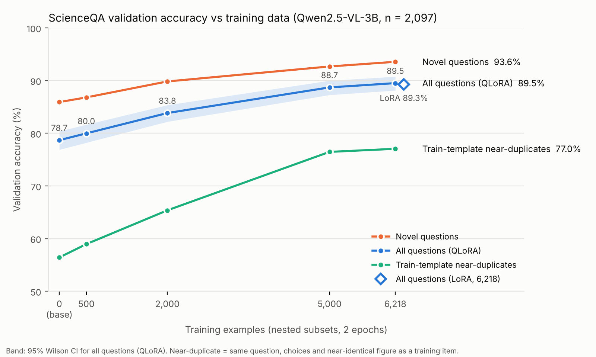

# Data-scaling study (blueprint §7.3): QLoRA, A1 targets, full validation split

Every model is scored on the **full ScienceQA validation split: 2,097 image questions**, greedy decoding, batch 8.
Training subsets are nested (seed 42), and all other settings are the pilot's: r=16, α=32, 2 epochs, LR 1e-4,
batch 1 × 8, fp16 on one Kaggle T4. The test split is untouched.

Regenerate with `python scripts/plot_scaling.py` (reads every `*/result.json` in this folder).

## Results

| Model | Train examples | Accuracy (95% CI) | Δ vs M0 (paired bootstrap 95% CI) | McNemar (M0-only / model-only) | Novel (n=1,583) | Near-dup (n=514) | Train time | Peak train VRAM | Val loss |
|---|---:|---:|---:|---:|---:|---:|---:|---:|---:|
| M0 base | n/a | 78.7% (76.9–80.4) | n/a | n/a | 85.9% | 56.4% | n/a | n/a | n/a |
| QLoRA D1 | 500 | 80.0% (78.2–81.6) | +1.3 pp (+0.1, +2.4), p = 0.03 | 60 / 87, p = 0.03 | 86.8% (+0.9) | 59.0% (+2.5) | 26 min | 4.96 GB | 0.320 |
| QLoRA D2 | 2,000 | **83.8%** (82.2–85.3) | **+5.2 pp (+3.7, +6.5)**, p < 0.001 | 60 / 168, p = 5e-13 | 89.8% (+3.9) | 65.4% (+8.9) | 93 min | 4.96 GB | 0.179 |
| QLoRA D3 | 5,000 | **88.7%** (87.3–90.0) | **+10.0 pp (+8.4, +11.7)**, p < 0.001 | 61 / 271, p = 1e-32 | 92.7% (+6.8) | 76.5% (+20.0) | 261 min | 4.96 GB | 0.115 |
| QLoRA D4 | 6,218 (all) | **89.5%** (88.1–90.7) | **+10.8 pp (+9.1, +12.5)**, p < 0.001 | 62 / 289, p = 4e-36 | 93.6% (+7.6) | 77.0% (+20.6) | 282 min | 4.95 GB | 0.104 |
| LoRA D4 | 6,218 (all) | **89.3%** (87.9–90.5) | **+10.6 pp (+9.0, +12.3)**, p < 0.001 | 55 / 277, p = 9e-37 | 93.1% (+7.2) | 77.4% (+21.0) | 288 min | 8.82 GB | 0.105 |

**Marginal gains between budgets (paired):**

| Step | Δ accuracy (95% CI) | McNemar | Reading |
|---|---:|---:|---|
| 500 → 2,000 | +3.9 pp (+2.7, +5.1) | 45 / 126, p = 4e-10 | large, clearly significant |
| 2,000 → 5,000 | +4.9 pp (+3.5, +6.3) | 54 / 156, p = 1e-12 | large, clearly significant |
| 5,000 → 6,218 | +0.8 pp (−0.1, +1.7) | 35 / 52, p = 0.09 | small, not significant at α = 0.05 |

**H4 (gains diminish with data): supported.** Accuracy rises steeply up to 5,000 examples, then flattens. The last 1,218
examples (+24% data) add under 1 pp.

D4 by subject: natural science 85.2%, social science 96.5%, language science 93.8% (n = 48). D4's validation loss
(300 examples) fell 0.199 → 0.147 → 0.125 → 0.113 → 0.105 → 0.104 at steps 250–1,500, flattening only in the last
quarter. Generation: 59.3 tokens per answer, 32.7 tokens/s (batch 8), peak inference VRAM 3.9 GB.

D2 by subject: natural science 75.9 → 78.9% (+3.0, p < 0.001); social science 82.5 → 92.0% (+9.4, p < 0.001);
language science 91.7 → 87.5% (n = 48, not significant).

## LoRA vs QLoRA at full data (6,218 examples): H2 and H3

| Metric | LoRA (fp16 base) | QLoRA (4-bit NF4 base) | Difference |
|---|---:|---:|---:|
| Validation accuracy | 89.3% | 89.5% | QLoRA − LoRA = +0.2 pp (−0.6, +1.1), p = 0.61; McNemar 36 / 41, p = 0.65 |
| Novel / near-dup accuracy | 93.1% / 77.4% | 93.6% / 77.0% | +0.4 / −0.4 pp (both n.s.) |
| Same predicted answer | | | 95.9% of questions |
| **Peak training VRAM** | 8.82 GB | **4.95 GB** | **−44%** |
| Training time (12,436 example-passes) | 288 min | 282 min | about equal |
| Final validation loss | 0.105 | 0.104 | about equal |
| **Peak inference VRAM** | 7.72 GB | **3.90 GB** | **−49%** |
| Generation speed (batch 8) | **41.6 tok/s** | 32.7 tok/s | QLoRA 21% slower (4-bit dequantization on T4) |
| Trainable parameters / adapter size | 7.37 M / 28.2 MB | 7.37 M / 28.2 MB | identical |

- **H2 (LoRA ≈ QLoRA in task performance): supported** at the full budget, now *with* a large gain over the base for both.
  The 95% CI on the difference rules out more than about 1 pp in either direction.
- **H3 (QLoRA reduces training memory): supported.** 44% less peak training memory at the same wall-clock time.
- **Trade-off:** QLoRA halves memory for training and serving, but generates about 20% slower on a T4. On 16 GB GPUs, QLoRA is
  the better default. If latency matters and memory is available, LoRA (or a merged LoRA) serves faster.

## Notes

- **The gain is not only template memorisation.** Near-duplicate items gain more (D2 +8.9 pp, D4 +20.6 pp), but novel
  items also improve significantly (D2 +3.9 pp, CI +2.5 to +5.3; D4 +7.6 pp, CI +6.1 to +9.2). The gap between the two groups
  grows with data, so part of the D4 gain on templated questions is likely familiarity with those templates. Report both
  numbers rather than only the headline.
- **500 examples, revisited:** on the full validation split, the 500-example adapter gives a small but significant +1.3 pp
  (p = 0.03). The 500-question pilot (run 03) could not resolve it (0.0 pp, CI ±2.3). The retrained adapter reproduced the
  pilot's validation loss exactly (0.31966), which confirms training is deterministic for a fixed seed and data.
- **Batch-composition effect:** M0's outputs on the 500 pilot questions differ in explanation *wording* on 19/500 items when
  they are batched with different neighbours (fp16 + left padding). The predicted answer letter is identical on all 500,
  so accuracy is unaffected. Within one evaluation run, results are deterministic.
- **Kaggle inputs:** attaching an earlier notebook's output through the API did not mount anything (`/kaggle/input` was empty).
  Adapters for the final test-set evaluation will be published as a Kaggle dataset instead.
